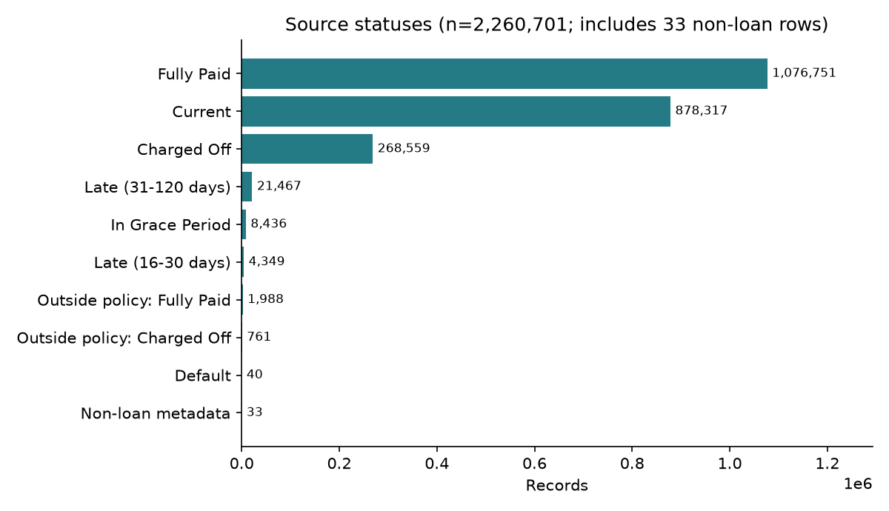
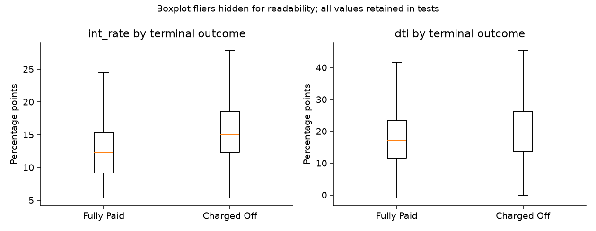
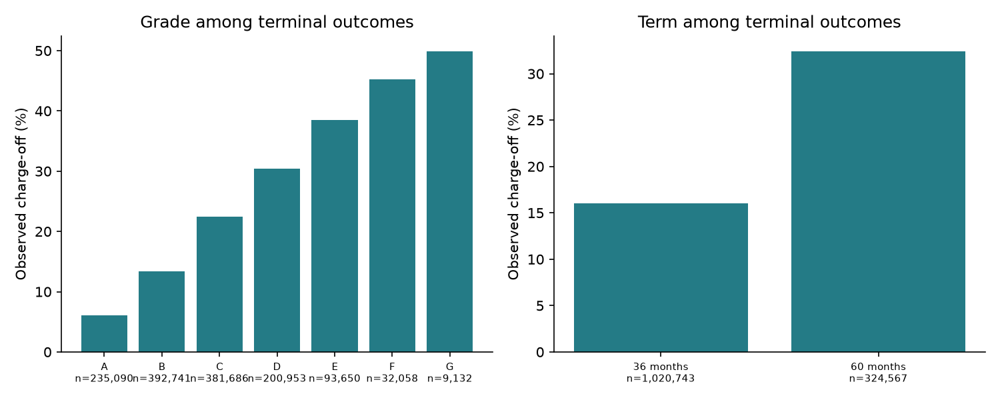
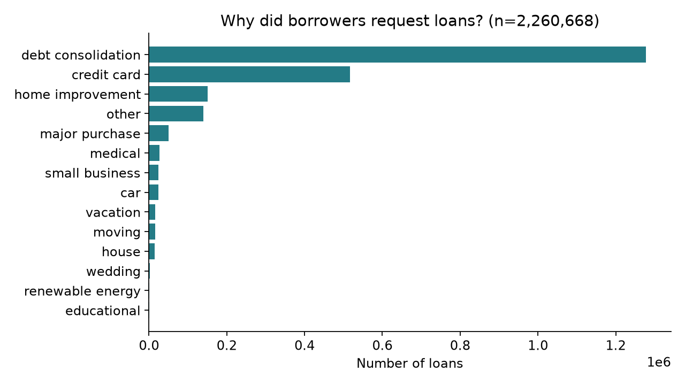
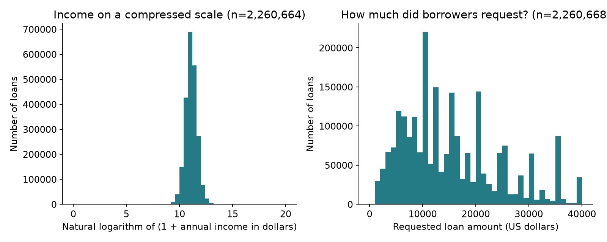
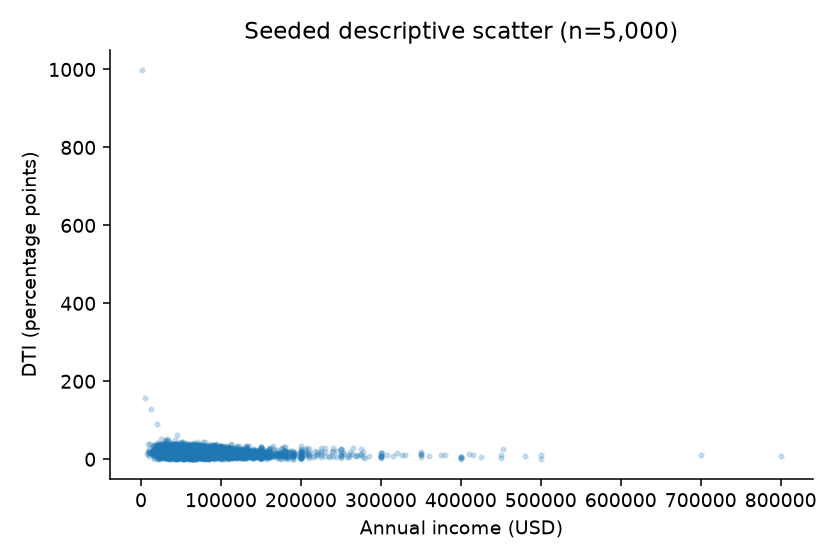
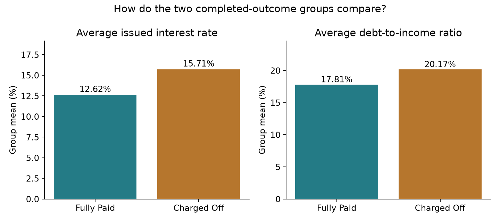

<<<<<<< HEAD
# NullPointer | LendingClub repayment outcomes

**CSE558 Data Science · IIIT-Delhi · Monsoon 2026**

[Project repository](https://github.com/krishiv-rtx/Data-Science-Project) · [Final PDF report](reports/final_report.pdf) · [Statistical methodology](reports/methodology_and_results.md) · [Technical explanation](reports/detailed_technical_report.md)

## Start here: understand the project in one pass

1. **Question:** How do issued loan characteristics differ between loans recorded as Fully Paid and Charged Off?
2. **Population:** The source contains 2,260,701 records, including 33 metadata records. Tests use 1,345,310 terminal-outcome loans; unresolved outcomes are excluded.
3. **Preparation:** Audit every column, check identifiers and duplicates, strip category whitespace, parse measurements, and use test-specific observed values. Preserve unusual measurements in primary tests and disclose sensitivities.
4. **Evidence:** Compare the group means for interest rate and debt burden, then grade association and term-specific charge-off proportions. Report magnitude, uncertainty and practical thresholds.
5. **Interpretation:** These are conditional historical associations. Borrower mix, incomplete follow-up and dependence prevent causal claims.
6. **Reproduce:** Follow the installation and one-command rebuild instructions below. The raw source file is external; generated figures and reports are already included.

## Navigation

| Need | Open |
| --- | --- |
| Submission report, including plain-language reference | [Final PDF](reports/final_report.pdf) |
| Every acronym and statistical symbol explained | [Acronym directory](reports/acronym_directory.md) |
| Selected attributes and all 151 source fields | [Plain-language attribute guide](reports/attributes_plain_language.md) |
| Exact units, derived variables and temporal caveats | [Data dictionary](reports/data_dictionary.md) |
| Test formulas, hypotheses, alternatives and actual results | [Methodology](reports/methodology_and_results.md) |
| Full explanation and limitations | [Technical report](reports/detailed_technical_report.md) |
| Presentation preparation | [Viva questions](reports/viva_questions_and_answers.md) |
| Machine-readable findings | [Result records](outputs/results.json) |

## What the four tests say

| Question / variable | Test | Estimate | 95% confidence interval | Units | Interpretation |
| --- | --- | --- | --- | --- | --- |
| int_rate | Welch t | 3.0874 | 3.0670 to 3.1079 | percentage points | Above the declared threshold; association only |
| dti | Welch t | 2.3596 | 2.3103 to 2.4089 | percentage points | Above the declared threshold; association only |
| grade | Chi-square independence | 0.2619 | 0.2603 to 0.2635 | Cramer's association measure | Above the declared threshold; association only |
| term | Two-proportion z | 16.4519 | 16.2759 to 16.6280 | percentage points | Above the declared threshold; association only |

The numeric contrasts are Charged Off minus Fully Paid; the term contrast is 60 months minus 36 months. All four null hypotheses are rejected under the working assumptions, including Holm adjustment. Statistical evidence is not proof of causation.

## Project theme and features

A reproducible investigation of how issued loan characteristics relate to observed terminal repayment outcomes. The project connects full-file quality auditing, interpretable exploratory plots, four statistical tests, confidence intervals and practical significance. The visual theme uses teal for observed patterns and amber for comparison thresholds. Findings describe historical associations subject to selection, maturity and dependence limitations.

| Team member | Roll number | Institute email |
| --- | --- | --- |
| Satyam Singh | 2024514 | satyam24514@iiitd.ac.in |
| Satguru Saran | 2024510 | satguru24510@iiitd.ac.in |
| Krishiv Vats | 2024308 | krishiv24308@iiitd.ac.in |

| Feature | What the project provides |
| --- | --- |
| Full-file audit | 2,260,701 source records, 151 columns; source identity and quality checks |
| Explicit population | 1,345,310 Fully Paid / Charged Off loans; unresolved outcomes excluded |
| Statistical inference | Two Welch tests, grade chi-square and term proportion z-test |
| Practical interpretation | Original-scale estimates, 95% intervals, thresholds and sensitivity checks |
| Encoding audit | 1,344,080 × 40 = 53,763,200 actual instance-attribute cells |
| Reproducibility | Modular scripts, executed notebooks, automated checks and generated reports |

## Plot gallery and reading guide

### 1. Recorded loan statuses



Current loans are unresolved, which determines the eligible denominator.

### 2. Interest-rate and debt-to-income distributions



The centre line is the median; the box is the middle half of values. Hidden fliers remain in tests.

### 3. Charge-off proportions by grade and term



Category differences describe terminal loans and are affected by maturity and borrower mix.

### 4. Why borrowers requested loans



A familiar count bar chart makes common borrowing reasons easy to compare.

### 5. Income and requested loan sizes



Left: natural log(1 + annual income). Right: a conventional dollar-scale loan-amount histogram. The logarithm changes interpretation and does not retain all original-scale information.

### 6. Income and debt-to-income scatter



Each point is one sampled terminal loan. Outlying points warn against treating averages as the whole story.

### 7. Two easy-to-read group-average comparisons



Zero-based bars compare the average issued interest rate and debt-to-income ratio for Fully Paid and Charged Off loans. Test tables provide confidence intervals.

## Complete deliverable directory

Generated caches and temporary PDF-review files are omitted below. The raw CSV is external as documented in `data/raw/README.md`.

```text
lendingclub-midterm-project/
├── data/
│   ├── processed/
│   │   └── README.md
│   └── raw/
│       └── README.md
├── figures/
│   ├── eda/
│   │   ├── category_rates.png
│   │   ├── income_and_loan_amount.png
│   │   ├── income_dti.png
│   │   ├── income_transform.png
│   │   ├── loan_purposes.png
│   │   ├── missingness.png
│   │   ├── outcome_boxplots.png
│   │   └── status.png
│   └── inference/
│       ├── effect_intervals.png
│       └── group_mean_comparison.png
├── notebooks/
│   ├── 01_data_audit.ipynb
│   ├── 02_data_preparation_and_eda.ipynb
│   └── 03_statistical_inference.ipynb
├── outputs/
│   ├── logs/
│   ├── tables/
│   │   ├── before_after.csv
│   │   ├── cohort_term_rates.csv
│   │   ├── explainer_plot_counts.json
│   │   ├── feature_audit.csv
│   │   ├── grade_outcome.csv
│   │   ├── group_summaries.csv
│   │   ├── hypothesis_tests.csv
│   │   ├── missingness.csv
│   │   ├── numeric_summary.csv
│   │   ├── outliers.csv
│   │   ├── profile_comparison.csv
│   │   ├── profile_numeric_comparison.csv
│   │   ├── profile_status_comparison.csv
│   │   └── term_outcome.csv
│   ├── dataset_audit.json
│   ├── encoded_size.json
│   ├── pdf_validation.json
│   ├── pdf_visual_review.json
│   ├── preparation.json
│   ├── quality_flags.json
│   ├── report_result_crosscheck.json
│   ├── results.json
│   ├── run_summary.json
│   ├── sensitivity.json
│   └── validation.json
├── reports/
│   ├── acronym_directory.md
│   ├── analysis_plan.md
│   ├── attributes_plain_language.md
│   ├── data_dictionary.md
│   ├── detailed_technical_report.md
│   ├── final_report.pdf
│   ├── final_report.tex
│   ├── limitations_and_future_work.md
│   ├── methodology_and_results.md
│   ├── references.md
│   ├── syllabus_mapping.md
│   ├── validation_summary.md
│   └── viva_questions_and_answers.md
├── scripts/
│   ├── check_quality.py
│   ├── check_report_results.py
│   ├── compile_report.py
│   ├── create_notebooks.py
│   ├── create_viva.py
│   ├── execute_notebooks.py
│   ├── generate_explainer_figures.py
│   ├── generate_reports.py
│   ├── generate_summary_figures.py
│   ├── package_project.py
│   ├── reproduce.py
│   ├── run_all.py
│   └── validate_project.py
├── source_materials/
│   ├── CSE558_Project_Report_Guidelines.pdf
│   ├── CSE558_Project_Report_Template.pdf
│   ├── CSE558_Project_Report_Template.tex
│   ├── LendingClub_Dataset_Profile_Report.pdf
│   └── master prompt.txt
├── src/
│   ├── __init__.py
│   ├── config.py
│   ├── data_loading.py
│   ├── data_quality.py
│   ├── eda.py
│   ├── feature_audit.py
│   ├── preprocessing.py
│   ├── reader_guide.py
│   ├── report_presentation.py
│   ├── reporting.py
│   └── statistical_tests.py
├── tests/
│   ├── test_data_quality.py
│   ├── test_preprocessing.py
│   └── test_statistical_tests.py
├── .gitignore
├── FILE_MANIFEST.json
├── LICENSE_OR_DATA_NOTICE.md
├── README.md
└── requirements.txt
```

## Installation, execution and audit details
=======
# NullPointer - LendingClub midterm project

Statistical inference on observed loan repayment outcomes. Team: Satyam Singh (2024514), Satguru Saran (2024510), Krishiv Vats (2024308). CSE558, IIIT-Delhi, Monsoon 2026.
>>>>>>> origin/main

## What was analysed

The supplied CSV was scanned in full by code; only a small initial sample and aggregate outputs were inspected in conversation. Actual dimensions: **2,260,701 rows x 151 columns**. The preliminary profile reports 314,168 x 162 and therefore must not be substituted for the actual CSV. Raw data remains unchanged and is not bundled in this ZIP. Original download URL, acquisition date and licence were not supplied; see LICENSE_OR_DATA_NOTICE.md and the recorded SHA-256.

Questions: do terminal Charged Off/Fully Paid loans differ in mean issued rate and DTI; is grade associated with terminal outcome; and do 60-/36-month loans have different observed terminal charge-off proportions? These are historical observational associations, not causal effects or predictions. Methods: two Welch tests, chi-square independence with Cramer's V, two-proportion z, Holm adjustment, and limited sensitivity checks. Read reports/analysis_plan.md for thresholds fixed before comparisons.

## Install (Windows PowerShell)

Python 3.14.3 was used; Python 3.11+ is a reasonable baseline, but the exact pinned dependency set was tested on the recorded version. Allow several GB of free RAM; the chunked audit limits whole-file loading, although selected columns and encoded arrays still need memory. Raw input is 1,675,133,810 bytes. No GPU, cloud service or credentials are required.

```powershell
cd 'C:\path\to\lendingclub-midterm-project'
py -m venv .venv
.\.venv\Scripts\python.exe -m pip install -r requirements.txt
.\.venv\Scripts\python.exe scripts/run_all.py --data '..\accepted_2007_to_2018Q4.csv'
.\.venv\Scripts\python.exe scripts/generate_reports.py
.\.venv\Scripts\python.exe -m unittest discover -s tests -v
.\.venv\Scripts\python.exe scripts/execute_notebooks.py
.\.venv\Scripts\python.exe scripts/compile_report.py
```

Using the venv interpreter directly avoids PowerShell activation-policy problems. On macOS/Linux: `python3 -m venv .venv`, use `.venv/bin/python` in the same commands. Alternatively place the CSV in data/raw/accepted_2007_to_2018Q4.csv and omit `--data`. Relative paths are resolved from the working directory for an explicit data argument; internal outputs use the project root.

## Outputs and regeneration

- outputs/dataset_audit.json: exact file identity, dimensions, every column's missingness, status counts and duplicate checks.
- outputs/encoded_size.json: **1,344,080 x 40 = 53,763,200 instance-attribute cells**; actual matrix, excluding IDs, outcome and leakage fields.
- outputs/results.json and outputs/tables/hypothesis_tests.csv: estimates, df, statistics, p-value bounds, intervals, sample sizes and thresholds.
- figures/eda/: six generated plots; source functions in src/eda.py. Regenerate by rerunning run_all.py with the raw file. Tables regenerate in the same run.
- reports/final_report.tex and compiled PDF: supplied-template adaptation with the official six-section structure.
- reports/detailed_technical_report.md: full explanation; methodology_and_results.md: compact calculation audit.
- reports/data_dictionary.md, syllabus_mapping.md, viva_questions_and_answers.md, limitations_and_future_work.md and references.md.
- notebooks/: audit, preparation/EDA and inference walkthroughs. Open with optional Jupyter (`python -m pip install jupyterlab`, then `python -m jupyter lab`). The included standard-library executor runs their plain-Python cells sequentially in isolated subprocesses and writes genuine execution outputs; it does not require Jupyter.

Reports are generated from computed outputs; editing the generated documents by hand will be overwritten on regeneration. Source inputs are preserved in source_materials. Run generate_reports.py only after the analysis completes successfully. All full-data plots and tables can be regenerated using run_all.py; no command downloads the raw dataset automatically.

One-command rebuild (all stages, raw data and TeX required): `python scripts/reproduce.py --data "../accepted_2007_to_2018Q4.csv"`. For portable Tectonic append `--tectonic "PATH/tectonic.exe"`. This convenience wrapper dispatches the individually validated commands; the delivered run executed the stages individually. To regenerate aggregate-only figures without rereading the CSV use `python scripts/generate_summary_figures.py`; regenerate the viva with `python scripts/create_viva.py`. Recreate notebook source with `python scripts/create_notebooks.py`, then execute it. Full validation: `python scripts/validate_project.py`.

## LaTeX PDF

Install MiKTeX/TeX Live with `pdflatex`, then run `python scripts/compile_report.py` (two passes, page-limit check). The script also supports `--tectonic PATH` for a portable Tectonic compiler. Manual pdfLaTeX: change into reports and run `pdflatex -interaction=nonstopmode -halt-on-error final_report.tex` twice. Tectonic may require first-run internet access for TeX packages. PDF validation status is recorded in outputs/pdf_validation.json if successfully compiled. Never substitute a random Markdown-to-PDF layout for the provided template.

## Known limits and submission edits

<<<<<<< HEAD
Lectures 1-12, quiz materials and practice problems were absent; exact syllabus coverage and the 80% target are unverified. Supply those to complete the course mapping. The report includes the supplied institute emails and project repository URL. The contribution column has been removed as requested. No Git repository was created. Review selection, censoring, missingness, dependence and subjective thresholds in the limitations document.
=======
Lectures 1-12, quiz materials and practice problems were absent; exact syllabus coverage and the 80% target are unverified. Supply those to complete the course mapping. The report includes editable email/contribution and code URL fields, because those were not supplied. Replace them with true group details and your repository URL before submission. No Git repository was created. Review selection, censoring, missingness, dependence and subjective thresholds in the limitations document.
>>>>>>> origin/main

## Troubleshooting and completion checklist

File-not-found: supply a quoted absolute path with `--data` or place the input in data/raw. Missing package: use the same interpreter for pip and execution. Memory pressure: reduce chunk size in load_and_audit; selected-column/encoding memory still remains, so close other large applications. Unexpected categories or IDs: the pipeline stops instead of silently changing the research population; inspect the audit and document a justified correction. Missing TeX package: allow your TeX distribution to install it or use the portable compiler; inspect outputs/logs/latex.log. Missing output JSON: rerun the analysis before reports/notebooks. Test-fixture permission errors: run from a normal user terminal with a writable TEMP directory.

- Verify raw SHA-256 and dimensions match the intended file.
- Verify row-count reconciliation, four completed tests and actual encoded-size arithmetic.
- Verify all unit tests and notebook executions succeeded in outputs/validation.json.
- Verify PDF compilation and page count in outputs/pdf_validation.json.
- Inspect the final PDF visually, fill the personal/code fields and supply missing syllabus references.
<<<<<<< HEAD

## Acronyms and selected attributes at a glance

| Short form | Expansion | Meaning |
| --- | --- | --- |
| DTI | Debt-to-income ratio | How much income is committed to debt obligations; expressed as a percentage. Exact historical debt definitions require source documentation. |
| FICO | Fair Isaac Corporation credit score | A credit-history score; a higher score generally indicates stronger recorded credit history, not certainty of repayment. |
| CI | Confidence interval | A range from a procedure with stated long-run coverage, conditional on sampling assumptions. |
| SD | Standard deviation | How spread out individual observations are. |
| SE | Standard error | How uncertain an estimated mean or difference is. |
| df | Degrees of freedom | The reference distribution parameter used by a statistical test. |
| IQR | Interquartile range | Third quartile minus first quartile: the spread of the middle half of values. |
| CO | Charged Off | Recorded terminal charge-off outcome; not a synonym for every unresolved or late loan. |
| FP | Fully Paid | Recorded terminal full-repayment outcome. |
| EDA | Exploratory data analysis | Plots and summaries used to understand the observations. |
| H0 | Null hypothesis | The equality or independence statement tested. |
| H1 | Alternative hypothesis | The difference or association statement investigated. |
| IID | Independent and identically distributed | A working sampling assumption used by the bootstrap; not verified for loans. |
| USD | United States dollars | Currency used for recorded income and principal amounts. |
| CSV | Comma-separated values | The source table file format. |
| SHA-256 | Secure Hash Algorithm, 256-bit | A file fingerprint used to identify the exact input. |
| Holm | Holm multiple-testing adjustment | An adjustment addressing the four-test family; a name, not an acronym. |
| p-value | Null-tail probability | Probability of a statistic at least as extreme under the null and working assumptions; not the probability the null is true. |
| alpha | Significance level | The chosen false-positive criterion, 0.05 for these tests. |
| percentage point | Absolute difference between percentages | For example, 20% minus 18% is 2 percentage points, not a 2% relative increase. |

| Attribute | Plain meaning | What it signifies |
| --- | --- | --- |
| id | Loan identifier | Tracks a loan; has no numerical risk interpretation. |
| loan_status | Recorded loan outcome | Defines Fully Paid and Charged Off groups; Current is unresolved. |
| issue_d | Loan issue month | Shows loan vintage and helps explain maturity differences. |
| loan_amnt | Requested loan amount, in dollars | Shows the size of the loan, not the amount repaid. |
| int_rate | Issued annual interest rate, in percent | The price charged for borrowing; tested between outcome groups. |
| dti | Debt-to-income ratio, in percent | A debt-burden measure; higher means more debt relative to income. |
| annual_inc | Reported annual income, dollars per year | Borrower income scale; zero/extreme values need context. |
| fico_range_low | Lower end of the origination credit-score band | An approximate credit-score range endpoint, not the exact score. |
| revol_util | Revolving credit utilisation, in percent | How much of available revolving credit is used; unusually large values need review. |
| grade | Recorded loan grade, A through G | An ordered underwriting label, not an equally spaced number. |
| term | Scheduled loan duration, in months | The comparison uses 36-month and 60-month loans. |
| home_ownership | Reported housing situation | For example, rent, mortgage or own; a category, not wealth itself. |
| verification_status | Recorded income-verification category | Describes verification status; does not guarantee truthful income. |
| purpose | Stated reason for borrowing | For example, debt consolidation; self-reported category. |
| application_type | Individual or joint application | Helps interpret why joint-applicant fields may be missing. |
| charged_off | Derived 1 for Charged Off, 0 for Fully Paid | Defined only in the selected terminal-outcome sample. |

## Rebuilding the replacement plots

Run `python scripts/generate_explainer_figures.py --data "../accepted_2007_to_2018Q4.csv"` once to create the aggregate histogram and purpose counts. Later runs can omit `--data` to use `outputs/tables/explainer_plot_counts.json`. This cache stores bin counts and category totals, not borrower rows. Then regenerate reports with `python scripts/generate_reports.py` and compile the PDF.
=======
>>>>>>> origin/main
